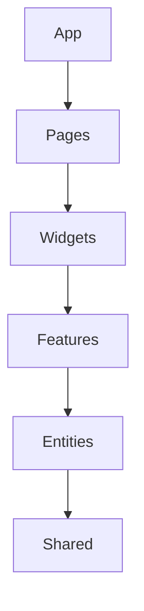

# Лабораторна робота №5

SPA на Vue 3 + TypeScript: Vue Router, Repository pattern, DummyJSON CRUD, JWT-авторизація, Pinia, VeeValidate/Yup.

## Запуск

```bash
cp .env.example .env
npm install
npm run dev
```

Тестовий користувач: `emilys` / `emilyspass`.

## Перевірки

```bash
npm run type-check
npm run lint
npm run build
```

CRUD DummyJSON є симуляцією: API повертає результат, але не зберігає зміни на сервері. Store одразу оновлює локальний стан інтерфейсу.

## FSD dependency flow



Імпорти дозволені лише в напрямку до нижчих шарів. Кожен slice відкриває Public API через `index.ts`.
